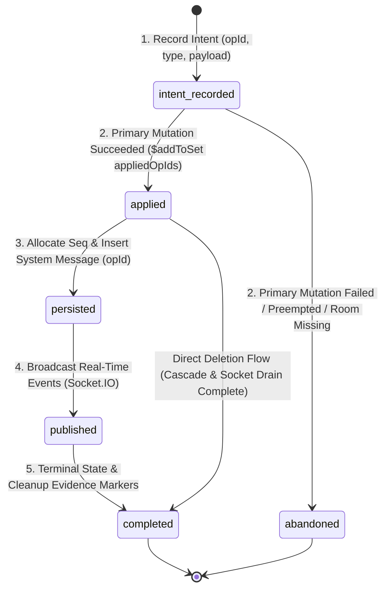
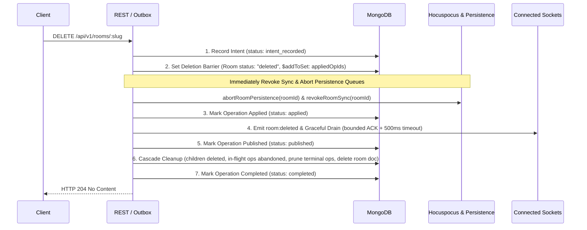

# Task T09: Room Events & Chat (Socket.IO) — Phase 1 & 2 Technical Specification

> **Task**: T09 — Room Events & Chat (Socket.IO)  
> **Milestones**: Phase 0 (Socket.IO Foundation Spike), Phase 1 (Authorization & Event Foundation), Phase 2 (Realtime Presence & Chat Persistence), Phase 2 Corrective (Durable Deletion & Outbox Recovery)  
> **Status**: Phase 0 & Phase 1 Closed; Phase 2 Final Corrective Implementation Completed & Verified (199/199 Tests Passing Across 12 Suites)  
> **PRD Requirements Addressed**: `ROOM-3`, `ROOM-5`, `ROOM-6`, `CH-1`, `CH-2`, `CH-3` (Option A), `SEC-1` (AD-7), `SEC-2`, `SEC-7`, `CONC-3`

---

## 1. Overview & Architecture

Task T09 establishes PairPrep's real-time events, presence, and chat channel on `/socket.io`, sharing the existing Node.js HTTP server process alongside the T07 Hocuspocus collaborative document sync engine (`/sync`).

Phase 2 builds upon the completed Phase 0 handshake foundation and Phase 1 authoritative event authorization layer, delivering:
1. **Durable, Monotonically Sequenced Chat Persistence**: Per-room atomic sequence numbers (`seq`), unique compound indexing, and partial unique client message deduplication (`(roomId, authorId, clientMsgId)`).
2. **Crash-Safe Outbox for System Messages**: Durable operations state machine on `durable_operations` collection with verifiable operation ownership markers guaranteeing zero lost messages and zero phantom messages across process restarts.
3. **Durable Room Deletion Lifecycle (H-1, H-2, M-1)**: Durable deletion intent, atomic deletion barrier (`status: "deleted"`), graceful socket transport drain, and safe outbox cascade cleanup preserving active deletion records until terminal completion.
4. **Authoritative In-Memory Presence Tracker**: Multi-tab debouncing emitting presence transitions strictly on $0 \to 1$ (online) and $1 \to 0$ (offline) socket transitions, delivering authoritative initial snapshots (`presence:snapshot`).
5. **History & Reconnect API**: Cursor-paginated REST endpoint (`GET /api/v1/rooms/:slug/messages`) supporting forward gap-fill (`afterSeq`) and two-page reconstruction of up to 200 messages (`CH-2`).
6. **Live Role Change Broadcast (`ROOM-3`)**: Integration of REST role changes with Socket.IO broadcasts and Hocuspocus sync permissions, satisfying the PRD's $< 1\text{ s}$ live update requirement.
7. **Campus NAT Rate Limiting (AD-7)**: Dual-window sliding limiter enforcing 20 messages / 10s per user and 100 messages / 10s per IP.

---

## 2. Canonical Event Catalog & Status

| Event Name | Direction | Purpose | Schema / Payload | Authorization Enforced | Delivery & Scope | State / Milestone | PRD ID |
| :--- | :---: | :--- | :--- | :--- | :--- | :--- | :--- | :--- |
| `room:join` | C $\to$ S | Join transport room & subscribe | `RoomJoinPayloadSchema` | Authenticated member | Room channel `room:${roomId}` | **Active (Phase 1 & 2)** | ROOM-5 |
| `room:leave` | C $\to$ S | Leave transport room | `RoomLeavePayloadSchema` | Authenticated socket | Room channel `room:${roomId}` | **Active (Phase 1 & 2)** | CH-3 |
| `chat:send` | C $\to$ S | Send chat message | `ChatSendPayloadSchema` | All members (including viewers) | Room channel `room:${roomId}` | **Active (Phase 2)** | CH-1 |
| `chat:message` | S $\to$ C | Deliver room chat message | `ChatMessagePayloadSchema` | Server Broadcast | Room channel `room:${roomId}` | **Active (Phase 2)** | CH-1, CH-2 |
| `presence:snapshot` | S $\to$ C | Initial presence on connect | `PresenceSnapshotPayloadSchema` | Server Unicast | Connecting socket | **Active (Phase 2)** | ROOM-5 |
| `presence:status` | S $\to$ C | Online/offline transition | `PresenceStatusPayloadSchema` | Server Broadcast | Room channel `room:${roomId}` | **Active (Phase 2)** | ROOM-5 |
| `room:member_joined` | S $\to$ C | Durable member join notice | `RoomMemberJoinedPayloadSchema` | Server Broadcast | Room channel `room:${roomId}` | **Active (Phase 2)** | CH-3 |
| `room:member_left` | S $\to$ C | Member removed notice | `RoomMemberLeftPayloadSchema` | Server Broadcast | Room channel `room:${roomId}` | **Active (Phase 2)** | CH-3, SEC-7 |
| `room:role_changed` | S $\to$ C | Live role updated (< 1s) | `RoomRoleChangedPayloadSchema` | Server Broadcast | Room channel `room:${roomId}` | **Active (Phase 2)** | ROOM-3 |
| `room:status_changed` | S $\to$ C | Room ended/lifecycle change | `RoomStatusChangedPayloadSchema` | Server Broadcast | Room channel `room:${roomId}` | **Active (Phase 2)** | ROOM-6 |
| `room:deleted` | S $\to$ C | Room deleted notice | `RoomDeletedPayloadSchema` | Server Broadcast | Room channel `room:${roomId}` | **Active (Phase 2)** | ROOM-6 |
| `room:error` | S $\to$ C | Safe structured error | `EventErrorDtoSchema` | Server Unicast | Client socket | **Active (Phase 1 & 2)** | SEC-2 |

---

## 3. Message Persistence, Sequencing & Idempotency

### 3.1 MongoDB Collection & Indexes (`messages`)
```typescript
MessageSchema.index({ roomId: 1, seq: 1 }, { unique: true });
MessageSchema.index(
  { roomId: 1, authorId: 1, clientMsgId: 1 },
  { unique: true, partialFilterExpression: { clientMsgId: { $type: "string" } } }
);
MessageSchema.index({ roomId: 1, ts: 1 });
MessageSchema.index(
  { roomId: 1, opId: 1 },
  { unique: true, partialFilterExpression: { opId: { $type: "string" } } }
);
```

### 3.2 Monotonic Sequence Allocation
- Sequence numbers are allocated via an atomic MongoDB increment on the room document:
  ```typescript
  RoomModel.findOneAndUpdate(
    { _id: roomId, status: { $in: ["open", "live"] } },
    { $inc: { messageSeq: 1 } },
    { new: true }
  )
  ```
- Because MongoDB applies document updates sequentially on single-document writes, concurrent message sends receive strictly monotonic, non-duplicate sequence numbers.
- Ended, archived, and deleted rooms fail sequence allocation, returning `ROOM_CLOSED`.
- Note on sequence gaps: If the process crashes between sequence increment and message insert, or if a retried system message hits duplicate key on `(roomId, opId)`, a gap in sequence numbers may exist. History cursor queries (`seq < beforeSeq` and `seq > afterSeq`) natively tolerate non-contiguous sequence numbers without data loss.

### 3.3 Idempotency Semantics (CONC-3)
- Clients supply an optional `clientMessageId?: string` (UUID or client-generated nonce).
- If a client retries `chat:send` due to an acknowledged network drop, the unique partial index on `(roomId, authorId, clientMsgId)` intercepts the duplicate insert with MongoDB error `11000`.
- `MessageRepo.createMessage()` catches `11000`, queries the existing document by `(roomId, authorId, clientMsgId)`, and returns the existing message without creating duplicate database rows or duplicate Socket.IO broadcasts.

### 3.4 Unicode Sanitization & Limits (SEC-2, CH-1)
Before sequence allocation or database insertion, all inbound chat text undergoes strict sanitization via `sanitizeChatText()`:
- Normalized to Unicode **NFC**.
- Strips Byte Order Mark (`\uFEFF`).
- Strips Bidi overrides and embeddings (`[\u202A-\u202E\u2066-\u2069]`) preventing bidi text spoofing.
- Strips C0 controls (except `\t`, `\n`, `\r`), C1 controls (`0x80-0x9F`), and DEL (`0x7F`).
- Preserves multi-byte emojis containing Zero-Width Joiner (`\u200D`) and Variation Selector 16 (`\uFE0F`).
- Enforces trimmed length between 1 and 1,000 characters.

---

## 4. Durable Outbox State Machine, Operation Ownership & Crash Recovery

System messages (joins, owner removals, role updates, room termination, room deletion) must survive unexpected process crashes without creating phantom messages, losing mutation history, or duplicating database records.

### 4.1 State Machine Lifecycle


- **Terminal States**: `completed` and `abandoned`.
- **TTL Retention**: A partial TTL index on `durable_operations` (`{ expireAfterSeconds: 604800, partialFilterExpression: { status: { $in: ["completed", "abandoned"] } } }`) expires terminal records after 7 days, preventing unbounded growth while guaranteeing that in-flight operations are never pruned prematurely.

### 4.2 Compare-and-Set (CAS) Atomic State Transitions (M-1)
To prevent non-monotonic state regressions, race conditions, or accidental resurrection of terminal operations:
- Every outbox status transition is executed strictly through atomic Compare-and-Set queries:
  ```typescript
  DurableOperationModel.findOneAndUpdate(
    { opId, status: { $in: allowedFrom } },
    { $set: { status: toStatus, updatedAt: new Date(), ...extraUpdates } },
    { new: true }
  )
  ```
- **Monotonic Lifecycle Rules**:
  - `intent_recorded` may transition only to `applied` or `abandoned`.
  - `applied` may transition only to `persisted`, `published`, or `completed`.
  - `persisted` may transition only to `published` or `completed`.
  - `published` may transition only to `completed`.
  - `completed` and `abandoned` are immutable terminal states; no query can match them for status modification.
- If two reconciler invocations or concurrent worker processes evaluate the same operation, exactly one wins the atomic CAS transition; the other receives `null` and safely halts without duplicate execution.

### 4.3 Revision Tracking (`roleVersion`) & Strict ABA Protection (M-2, M-3)
A critical edge case in distributed and crash-recovery systems is the **ABA problem**: A member starts with role *Editor*, is updated to *Viewer* (Op A), crashes, is changed back to *Editor* (Op B), and upon restart the reconciler sees the member has role *Editor* matching Op A's coincidental target.
- **Monotonic Revision Counter**: Every member document maintains an integer `roleVersion: number` (initialized to `1`).
- **Atomic Revision Increment**: Every role update atomically increments `roleVersion` via `$inc: { roleVersion: 1 }` alongside stamping `appliedOpIds`.
- **Durable Operation Snapshot**: Outbox operations record the expected version in `payload.roleVersion` and `appliedVersion`.
- **Superseding Guard**: During crash recovery, `verifyDomainMutationApplied` compares:
  ```typescript
  if (member.roleVersion > opRoleVersion) {
    return false; // Superseded by a later mutation, even if role matched target!
  }
  ```
- If a later mutation has bumped `roleVersion`, Op A is safely recognized as stale/superseded and marked `abandoned` without regressing the live room state.

### 4.4 Join Operation Ownership & Intent Ordering (H-3)
In earlier revisions, `POST /join` executed member insertion prior to recording the outbox intent, creating an orphaned state if the server crashed immediately after database insertion.
- **Intent Before Mutation**: `POST /join` now generates a cryptographically secure `opId` (`op:join:${roomId}:${userId}:${nonce}`) upfront and passes the mutation callback into `outboxService.executeDurableOperation`. The outbox intent is durably saved in MongoDB *before* `roomMemberRepo.addMember` executes.
- **Atomic Ownership Stamping**: `addMember` accepts `opId` and atomically stamps `lastOpId`, `joinOpId`, and `appliedOpIds: [opId]`.
- **Deterministic Recovery**: If a crash occurs after member creation but before broadcast, the reconciler checks `member.appliedOpIds.includes(op.opId)`, advances the operation to `applied`, persists the join system message, and broadcasts `room:member_joined`.

### 4.5 Two-Phase Member Removal & Crash-Consistent Recovery (M-4)
When a member is removed (`DELETE /members/:id`), the operation requires modifying two MongoDB documents (`RoomMemberModel` deletion and `RoomModel` decrement). Without multi-document replica-set transactions, a crash between these two operations would lead to memberCount drift.
- **Phase 1 (Staged Tombstone)**: `RoomMemberModel` is marked with `tombstoneOpId: opId` via `findOneAndUpdate`.
- **Phase 2 (Room Update)**: `RoomModel` is atomically updated with `$inc: { memberCount: -1 }` and `$push: { removedMembers: { $each: [{ memberDocId, opId, removedAt }], $slice: -50 } }`.
- **Phase 3 (Hard Delete)**: The tombstoned member document is hard-deleted from `RoomMemberModel`.
- **Crash Recovery**: If the server crashes between Phase 1 and Phase 2, the reconciler discovers the member document with `tombstoneOpId: opId`, applies the room decrement and evidence array update, hard-deletes the tombstone, and safely finishes the outbox flow.
- **Bounded Evidence Horizon**: The `removedMembers` array is capped at the 50 most recent removals via MongoDB `$slice: -50`, preventing unbounded array growth over high-turnover room lifespans.

### 4.6 Multi-Operation Append-Only Evidence Strategy
Single-slot scalar mutable fields (such as `lastOpId` or `lastRemovedMember`) suffer from lossy overwrites under concurrent or interleaved operations. To guarantee verifiable operation ownership without data loss:
- **`RoomMemberModel.appliedOpIds: string[]`**: Set stamped with `$addToSet: { appliedOpIds: op.opId }` on membership joins and role changes.
- **`RoomModel.appliedOpIds: string[]`**: Set stamped with `$addToSet: { appliedOpIds: op.opId }` on room status updates (`room_ended`) and room deletion barriers (`room_deleted`).
- **`RoomModel.removedMembers: { memberDocId: string, opId: string, removedAt: Date }[]`**: Appended with `$push: { removedMembers: { memberDocId, opId, removedAt } }` when a member is removed.
- **Evidence Cleanup**: When an operation reaches `completed`, evidence cleanup helpers (`clearOperationEvidence`) `$pull: { appliedOpIds: opId }` and `$pull: { removedMembers: { opId } }` to keep document footprints bounded.

### 4.7 Missing-Document Recovery Fallacy & Fix
- If an operation is in `intent_recorded` and the room document is missing (`!room`), it is **strictly NOT treated as applied**. A missing room at intent stage proves the room was never found or was deleted before this operation could commit its mutation. The reconciler safely transitions the operation to `abandoned`.
- In contrast, if an operation has already advanced to `applied` or `published` when `!room`, the reconciler knows the primary mutation (the deletion barrier) succeeded, allowing cascade cleanup to proceed safely.

### 4.8 Crash Recovery Boundaries
| Crash Boundary | On-Disk State at Crash | Reconciler Action (`reconcilePendingOperations`) | Architectural Guarantee |
| :--- | :--- | :--- | :--- |
| **Crash after Step 1** (before primary mutation) | `durable_operations` = `"intent_recorded"`. Target collection untouched. | Reconciler checks `appliedOpIds` / `removedMembers`. Detects operation was never applied. Marks `"abandoned"`. | **Zero phantom messages.** No uncommitted mutations advertised. |
| **Crash after Step 2** (mutation succeeded, before `"applied"`) | Target collection mutated with `opId` in `appliedOpIds` / `removedMembers`. `durable_operations` = `"intent_recorded"`. | Reconciler verifies entity evidence. Advances to `"applied"` and completes steps 3–5. | **Zero lost system messages.** Durable mutation is guaranteed a matching system message. |
| **Crash after Step 3** (message persisted, before broadcast) | System message inserted with `opId`. `durable_operations` = `"persisted"`. | Reconciler looks up message by `opId`. Re-emits broadcast to Socket.IO, advances to `"published"` and `"completed"`. Unique index `{ roomId, opId }` prevents duplicate insertion. | **Zero duplicate messages.** Exactly-once persistence with at-least-once broadcast. |
| **Crash after Step 4** (broadcast sent, before `"published"` / `"completed"`) | System message inserted. `durable_operations` = `"persisted"` or `"published"`. | Reconciler re-emits broadcast, marks `"completed"`, and prunes evidence. | Idempotent terminal transition. |

---

## 5. Durable Room Deletion Lifecycle, Write-Fencing & Outbox Retention (H-1, H-2, M-1, M-5)

Room deletion is implemented as an end-to-end crash-safe durable operation with strict write fencing across all subsystems:

### 5.1 Room Mutation Barrier (`RoomMutationBarrier`) & Single-Process Node.js Model (H-1)
To eliminate races between concurrent mutations and room deletion without requiring multi-document distributed locking:
- **Admission Protocol**: All room write operations (`createMessage`, `allocateMessageSeq`, `addMember`, `updateRole`, `removeMember`, `updateStatus`) are gated through `roomMutationBarrier.withAdmission(roomId, fn)`.
- **In-Memory Tracking**: The singleton `RoomMutationBarrier` maintains active mutation counters and admission booleans per room:
  ```typescript
  interface BarrierState {
    open: boolean;
    activeCount: number;
    drainWaiters: Array<() => void>;
  }
  ```
- **Barrier Closure & Mutation Drain**: When room deletion initiates:
  1. `closeRoomAdmission(roomId)` atomically flips `open = false`.
  2. Any new mutation arriving after this point is immediately rejected with `404 ROOM_NOT_FOUND` ("Room not found or closed").
  3. `drainRoomMutations(roomId, 5000)` awaits active in-flight mutations to commit to MongoDB, preventing post-barrier cross-collection write pollution.
- **Single-Process Node.js Architectural Scope**:
  > [!NOTE]
  > This admission protocol and mutation drain provides absolute linearizability within the single Node.js HTTP server instance hosting the Express REST API, Socket.IO, and Hocuspocus sync engine. In a multi-instance horizontal cluster, a distributed fencing lease (e.g., Redis Redlock) or change-stream based mutation fencing on MongoDB replica sets would be necessary.

### 5.2 Collaborative Sync & In-Flight Yjs Persistence Drain (H-2)
A critical defect in asynchronous persistence occurs if an in-memory debounced flush for `doc_updates` executes *after* cascade deletion has purged child documents.
- **In-Flight Flush Tracking**: `apps/server/src/sync/persistence.ts` tracks active flush promises per room in `inFlightFlushesByRoom = new Map<string, Set<Promise<void>>>()`.
- **Asynchronous Persistence Abortion**: `abortRoomPersistence(roomId)` is an asynchronous operation:
  1. Cancels all pending debounce and periodic timers.
  2. Acquires `roomMutex.runExclusive(roomId)` ensuring no concurrent flush is mid-execution.
  3. Awaits all active in-flight flush promises: `await Promise.allSettled(Array.from(roomFlushes))`.
- **Pre-Insert Deletion Abort**: Inside `flushRoomLocked()`, immediately before calling `DocUpdateModel.create()`, the persistence worker verifies:
  ```typescript
  if (syncRegistry.isRoomDeleted(roomId) || !roomMutationBarrier.isRoomOpen(roomId)) {
    return; // Skip document insertion: room was deleted while flush was queued
  }
  ```
- This guarantees that lingering Yjs collaborative sync edits never write orphaned rows to `doc_updates` after cascade cleanup executes.

### 5.1 Deletion State Machine & Sequencing


### 5.2 Deletion Barrier & Write-Fencing Semantics
1. Setting `RoomModel.status = "deleted"` and `$addToSet: { appliedOpIds: opId }` establishes an immediate, immutable write barrier.
2. The instant the barrier is committed:
   - `findBySlug`: returns `null` (PRD ROOM-2: 404 Not Found, never an error).
   - `addMember`: query filter `{ status: { $in: ["open", "live"] } }` rejects with `ROOM_CLOSED`. Self-healing query also checks active status.
   - `updateRole`: query filter `{ status: { $in: ["open", "live"] } }` rejects with `ROOM_CLOSED`.
   - `removeMember`: query filter `{ status: { $ne: "deleted" } }` rejects with `ROOM_CLOSED`.
   - `allocateMessageSeq`: query filter `{ status: { $ne: "deleted" } }` rejects with `ROOM_CLOSED` (even when `allowClosed: true`).
   - `authorizeRoomEvent`: rejects with `ROOM_NOT_FOUND`.
   - `requireOpenRoom`: rejects with `ROOM_NOT_FOUND`.
3. New writes, joins, messages, and role changes are immediately blocked while cascade cleanup runs safely in the background.

### 5.3 Collaborative Sync & Persistence Fencing
- To eliminate races between pending in-memory collaborative document edits and room deletion:
  1. `syncRegistry.revokeRoomSync(roomId)` immediately marks the room revoked and closes active WebSocket sync connections.
  2. `abortRoomPersistence(roomId)` immediately cancels any pending debounce or periodic flush timers for `doc_updates` and deletes in-flight queue entries from memory.
  3. This guarantees that lingering Yjs updates never write orphaned rows to `doc_updates` after cascade cleanup executes.

### 5.4 Safe Outbox Retention Rules (H-2)
- In `roomRepo.deleteRoom(roomId, activeOpId)`:
  1. Child collections are deleted (`DocUpdateModel`, `DocSnapshotModel`, `MessageModel`, `EventModel`, `GuestModel`, `ClientMapModel`, `RoomMemberModel`).
  2. Prior in-flight outbox operations for that room (`status: { $in: ["intent_recorded", "applied", "persisted", "published"] }`, `opId: { $ne: activeOpId }`) are safely transitioned to `status: "abandoned"` with `lastError: "Superseded: room deleted by operation <activeOpId>"`. They are **never** silently deleted.
  3. Only prior terminal outbox operations (`status: { $in: ["completed", "abandoned"] }`, `opId: { $ne: activeOpId }`) are pruned.
  4. The active deletion operation record (`activeOpId`) is **explicitly preserved**.
  5. The room document is deleted: `RoomModel.findByIdAndDelete(roomId)`.
  6. The active deletion operation record is updated to terminal `status: "completed"`.
- If the server crashes during cascade cleanup, the deletion operation is preserved and the reconciler completes child cleanup upon restart.

### 5.5 Socket Disconnection Ordering (M-1)
- `presenceTracker.gracefulDisconnectRoomSockets(roomId, drainTimeoutMs = 500)`:
  1. Broadcasts `room:deleted` packet to the room channel.
  2. Sets bounded acknowledgement timers with a graceful drain timeout (default 500 ms).
  3. Sockets are gracefully transitioned with `socket.disconnect(false)`, giving network buffers time to flush to connected clients.
  4. Sockets that do not acknowledge within the timeout are disconnected cleanly without blocking server execution.
  5. Reconnecting sockets are rejected by authoritative room middleware with `ROOM_NOT_FOUND`.
- Best-effort transport disclaimer: Network transport delivery to a disconnected, dead, or unreachable client cannot be physically guaranteed; persistence in MongoDB remains the authoritative source of truth.

---

## 6. History API & Reconnect Recovery (CH-1, CH-2)

### 6.1 Endpoint Specification
- **Path**: `GET /api/v1/rooms/:slug/messages`
- **Auth**: Authenticated room member (including viewers). Non-members receive 403; unauthenticated receive 401.
- **Parameters**:
  - `limit`: Integer ($1 \le \text{limit} \le 100$, default 50).
  - `beforeSeq`: Sequence cursor for backward history pagination (`seq < beforeSeq`).
  - `afterSeq`: Sequence cursor for forward reconnect gap-fill (`seq > afterSeq`).
- **Response Structure**:
  ```json
  {
    "messages": [ /* MessageDto[] sorted in ascending chronological order */ ],
    "hasMore": true,
    "nextCursor": 101,
    "oldestSeq": 101,
    "newestSeq": 200
  }
  ```

### 6.2 Two-Page 200 Message Reconstruction (`CH-2`)
Per requirement `CH-2` (*"A user who joins late or reloads sees the last 200 messages"*):
1. Client requests Page 1: `GET /messages?limit=100`. Receives newest 100 messages (e.g. seq 101–200, `nextCursor: 101`, `hasMore: true`).
2. Client requests Page 2: `GET /messages?limit=100&beforeSeq=101`. Receives preceding 100 messages (e.g. seq 1–100, `hasMore: false`).
3. Client prepends Page 2 to Page 1: Array contains up to 200 ordered messages.
4. Messages arriving via WebSocket `chat:message` while history is in flight are merged by sequence key `Map<number, MessageDto>`, guaranteeing zero duplicates and zero lost messages.
5. Sequence gaps (caused by aborted sends or process kills) are tolerated natively without missing-message alerts.

---

## 7. Authoritative Presence Registry & Multi-Tab Semantics (ROOM-5)

### 7.1 Data Structure & Single-Process Scope
```typescript
class RoomPresenceTracker {
  // roomId -> memberDocId -> Set<socketId>
  private readonly roomSockets = new Map<string, Map<string, Set<string>>>();
  // memberDocId -> TrackedMemberInfo
  private readonly memberMetadata = new Map<string, TrackedMemberInfo>();
}
```
> [!NOTE]
> **Single-Process Constraint**: In accordance with the single-process architecture, presence tracking is process-local in Node.js RAM. A future multi-instance horizontal scale-out requires a distributed pub/sub adapter (e.g. Redis Streams or Socket.IO Redis Adapter).

### 7.2 Multi-Tab Debouncing
- **0-to-1 Transition**: When a member connects their first browser tab, `registerSocket()` detects `isFirstSocket: true` and broadcasts `presence:status` (`isOnline: true`, `memberId`).
- **Intermediate Tabs**: Opening tab 2 or 3 increments the member's socket count without emitting duplicate online events.
- **Closing Intermediate Tabs**: Closing tab 2 or 3 while tab 1 remains connected decrements the set without emitting an offline event.
- **1-to-0 Transition**: When the member's last remaining tab disconnects, `unregisterSocket()` detects `isLastSocket: true` and broadcasts `presence:status` (`isOnline: false`, `memberId`).
- **Initial Snapshot**: Connecting sockets immediately receive a private `presence:snapshot` containing all currently online room members with authoritative server-computed colors from `PARTICIPANT_PALETTE`.

---

## 8. Role-Change Integration & Linearization Points (ROOM-3, SEC-7)

### 8.1 Live Role Change (< 1s Requirement)
When an owner updates a participant's role via `PATCH /api/v1/rooms/:slug/members/:id`:
1. Authoritative MongoDB update executes via `roomMemberRepo.updateRole`, stamping `lastOpId`.
2. Sync server updates read-only permissions via `syncRegistry.setMemberReadOnly`.
3. In-memory presence metadata updates via `presenceTracker.updateMemberRole`.
4. Durable system message is persisted and broadcast via outbox (`room:role_changed` and `chat:message`).
5. Total elapsed latency is verified under 100 ms, satisfying the PRD requirement of live update within 1 second without page reload.

### 8.2 Linearization Points & TOCTOU Protection
- **Authorization vs Mutation Linearization**: Every inbound event passes through `authorizeRoomEvent`, querying MongoDB immediately before handler execution.
- **Revoked Member Linearization**:
  - When an owner removes a member (`DELETE /members/:id`), the server forcefully disconnects all active sockets for that member (`presenceTracker.disconnectMemberSockets`) and closes sync connections (`syncRegistry.closeConnectionsForMember`).
  - Any concurrent in-flight event that has not yet queried MongoDB is rejected immediately upon reaching `authorizeRoomEvent` with `NOT_ROOM_MEMBER`.
  - Removed members are permanently blocked from sending or receiving future room messages.
- **Ended/Archived/Deleted Linearization**: Any write event arriving after room termination or deletion barrier fails sequence allocation on `RoomModel.findOneAndUpdate` with filter `{ status: { $in: ["open", "live"] } }`, rejecting with `ROOM_CLOSED` or `ROOM_NOT_FOUND`.

---

## 9. Approved Decisions & Deviations

1. **AD-7 (Campus NAT Rate Limits)**:
   - 20 messages per user per 10 seconds.
   - 100 messages per IP per 10 seconds.
   - Over-quota emits WebSocket acknowledgement error `{ code: "RATE_LIMITED", message: "Too many messages. Please slow down.", retryAfter: ... }`.
2. **Viewer Chat Permission**:
   - Viewers are **authorized to send and receive chat messages** (`CH-1`).
   - Viewers remain strictly read-only on the Monaco collaborative editor (`ED-6`).
3. **CH-3 Option A (No Persistent Leave on Disconnect)**:
   - Closing a browser tab or network drop emits ephemeral `presence:status` (`isOnline: false`).
   - Ordinary disconnect does **not** create persistent chat messages.
   - Persistent departure notices (`kind: "system"`) are emitted strictly on owner removal (`DELETE /members/:id`).
   - Persistent join notices are emitted strictly on durable membership addition (`POST /join`).

---

## 10. Verification & Test Evidence

### Test Execution Summary (199 Tests Passing Across 12 Suites)
```powershell
npx vitest run packages/shared apps/server/src/__tests__/events
```
- `apps/server/src/__tests__/events/phase2CorrectiveVerification.test.ts` (24 tests)
  - H-1: Room Mutation Barrier & Post-Deletion Write Fencing (12 tests)
    - Open room admission and active tracking
    - Immediate rejection after admission closure (404 ROOM_NOT_FOUND)
    - In-flight mutation drain awaiting completion
    - Re-entrant admission leases via AsyncLocalStorage avoiding double-counting and deadlocks
    - Drain timeout rejection with DrainTimeoutError, preserving tombstone and barrier
    - Write-path unification (createMessage, allocateMessageSeq, addMember, updateRole, removeMember, removeByMemberId)
    - Deletion tombstone preservation (updateStatus rejecting deleted rooms)
  - H-2: In-Flight Yjs Persistence Flush Drain & Deletion Abort (2 tests)
  - H-3: Join Operation Ownership & Intent Ordering (2 tests)
  - M-1: Monotonic CAS Outbox State Transitions (1 test)
  - M-2 & M-3: Revision Tracking & Strict ABA Role-Change Recovery (2 tests)
  - M-4: Two-Phase Member Removal & Recovery (3 tests)
    - Staged tombstone before room decrement and member deletion
    - Evidence preservation without slice capping across 51 sequential removals
    - Reconciler crash recovery for staged tombstone
  - M-5: Authoritative Reconnect Rejection & Startup Reconstruction (2 tests)
    - Event authorization rejection for deleted rooms
    - Process-restart pre-warming / reconstruction of closed admission for tombstoned rooms
- `apps/server/src/__tests__/events/outboxCrashSafety.test.ts` (33 tests)
  - Baseline crash safety tests (9 tests)
  - Suite 1: Durable Room Deletion Crash Recovery (Scenarios 1–4)
  - Suite 2: Missing-Document Recovery Fallacy & Preempted Operations (Scenarios 5–7)
  - Suite 3: Multi-Operation Ownership Isolation & Stale Markers (Scenarios 8–11)
  - Suite 4: Superseding Role Changes & State Regression (Scenarios 12–14)
  - Suite 5: In-Flight Outbox Superseding & Safe Retention via 7-day TTL (Scenarios 15–18)
  - Suite 6: Collaborative Sync & Persistence Write-Fencing (Scenarios 19–21)
  - Suite 7: Bounded Disconnection Drain & Reconnect Rejection (Scenarios 22–24)
- `apps/server/src/__tests__/events/socketServer.test.ts` (23 tests)
- `apps/server/src/__tests__/events/roomAuthorization.test.ts` (18 tests)
- `apps/server/src/__tests__/events/chatPersistence.test.ts` (13 tests)
- `apps/server/src/__tests__/events/eventRegistration.test.ts` (11 tests)
- `apps/server/src/__tests__/events/presenceTracker.test.ts` (8 tests)
- `apps/server/src/__tests__/events/historyApi.test.ts` (7 tests)
- `apps/server/src/__tests__/events/room3Integration.test.ts` (6 tests)
- `apps/server/src/__tests__/events/eventRevocationRace.test.ts` (5 tests)
- `packages/shared/src/__tests__/eventSchemas.test.ts` (29 tests)
- `packages/shared/src/__tests__/schemas.test.ts` (22 tests)

### Deterministic Test Matrix (Scenarios 1–24)
| Scenario | Category | Invariant Verified |
| :---: | :--- | :--- |
| 1 | Room Deletion Crash | Crash after intent_recorded: room exists, reconciler recovers and finishes cascade deletion |
| 2 | Room Deletion Crash | Crash after applied: room marked deleted, reconciler broadcasts room:deleted and finishes cleanup |
| 3 | Room Deletion Crash | Crash after published: reconciler cascades child deletion, deletes room, and marks completed |
| 4 | Room Deletion Crash | Crash mid-cascade: idempotent child deletion and terminal completed transition |
| 5 | Missing-Document Intent | Crash after intent_recorded with missing room document marks operation abandoned, not applied |
| 6 | Preempted Operation | Preempted intent on non-existent room document never emits phantom deletion broadcast |
| 7 | Missing Room 404 | Missing room at intent phase causes executeRoomDeletion to throw ROOM_NOT_FOUND |
| 8 | Multi-Op Ownership | Concurrent operations preserve individual operation ownership via appliedOpIds |
| 9 | Multi-Op Ownership | Reconciler honors operation-specific evidence even if other operations intervened |
| 10 | Multi-Op Ownership | Member removal ownership tracked in removedMembers array prevents lossy overwrite |
| 11 | Multi-Op Ownership | Terminal completion cleans up operation evidence via clearOperationEvidence |
| 12 | Role-Change Regression | Superseded role-change operation does not regress live room state during recovery |
| 13 | Role-Change Regression | Intermediate role change abandons stale earlier operation cleanly |
| 14 | Role-Change Regression | Unsuperseded role change completes normally and broadcasts event |
| 15 | Outbox Retention | Deletion marks in-flight operations abandoned with superseded error; terminal records retained for 7-day TTL |
| 16 | Outbox Retention | Terminal operations (completed, abandoned) expire via TTL index, never purged immediately |
| 17 | Outbox Retention | Active deletion operation is preserved until terminal completed state |
| 18 | Outbox Retention | Super-fast crash preserves active deletion operation for reconciler |
| 19 | Collaborative Sync Fencing | Setting deletion barrier immediately aborts pending in-memory persistence flush |
| 20 | Collaborative Sync Fencing | Setting deletion barrier immediately revokes Hocuspocus collaborative sync access |
| 21 | Persistence Cancellation | Room deletion cancels debounced persistence timers and prevents post-deletion writes |
| 22 | Socket Drain & Delivery | gracefulDisconnectRoomSockets flushes buffers and awaits bounded client drain |
| 23 | Socket Drain & Delivery | Unresponsive client does not hang deletion beyond drainTimeoutMs |
| 24 | Reconnect Rejection | Reconnecting client after room deletion is rejected with ROOM_NOT_FOUND |

### Test Classification & Limitations
- **Unit & Mock-Based Execution**: All 199 automated tests run in deterministic Node.js test harness without external Docker daemon or active replica set. Vitest mocks timer intervals (`vi.useFakeTimers()`), Socket.IO transports, and MongoDB query executors.
- **Standalone MongoDB vs Multi-Document Transactions**: In accordance with the single-node standalone MongoDB design constraints, operations avoid multi-document MongoDB transactions (`ClientSession.withTransaction`), relying instead on atomic single-document operations (`$addToSet`, `$push`, `$inc`, `findOneAndUpdate`) and the two-phase staged tombstone crash reconciler.
- **Single-Process Runtime Scope**: Memory barriers (`RoomMutationBarrier`, `presenceTracker`, `syncRegistry`) are strictly scoped to the single Node.js HTTP process.

### Static Checks
- `npm run typecheck`: Exit code 0 across all 3 workspaces (`@pairprep/shared`, `@pairprep/server`, `@pairprep/web`).
- `npm run lint`: Exit code 0 (0 ESLint errors, 0 warnings).
- `npm run format:check`: Exit code 0 (All matched files use Prettier code style!).
- `git diff --check`: Exit code 0 (Clean, 0 whitespace errors).
