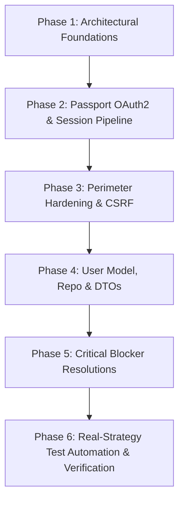

# Task 04 Complete Engineering Journey: Authentication & User Management

**Project:** PairPrep  
**Task ID:** T04  
**Author:** PairPrep Core Engineering Team  
**Date:** October 2026  
**Status:** Completed & Verified (CI Clean: 24/24 Test Suites Passed, 126 Passed, 1 Skipped)

---

## Executive Summary

Task 04 (T04) establishes production-ready authentication, session management, CSRF defenses, user profile lifecycle management, and rate limiting for the PairPrep platform according to PRD Sections 6.1 (AUTH-1 through AUTH-5) and 13.1.

This document details the complete end-to-end journey of Task 04—from initial requirements analysis, architecture, and technology selections, through iterative implementation, complex security blocker resolutions (including the Passport OAuth2 PKCE state store flaw), refactoring of legacy shims, hardening of data contracts, and full evidence collection.

---

## Table of Contents

1. [Scope & Requirements Overview](#1-scope--requirements-overview)
2. [Architectural Decisions & Trade-offs](#2-architectural-decisions--trade-offs)
3. [Technology Stack & Dependency Pinning](#3-technology-stack--dependency-pinning)
4. [Phase-by-Phase Implementation Journey](#4-phase-by-phase-implementation-journey)
   - [Phase 1: Foundations & Infrastructure](#phase-1-foundations--infrastructure)
   - [Phase 2: Passport OAuth2 & Session Pipeline](#phase-2-passport-oauth2--session-pipeline)
   - [Phase 3: Security & Perimeter Hardening](#phase-3-security--perimeter-hardening)
   - [Phase 4: User Profile Lifecycle & DTO Contract](#phase-4-user-profile-lifecycle--dto-contract)
5. [Critical Blockers, Bug Fixes & Iterative Refinements](#5-critical-blockers-bug-fixes--iterative-refinements)
   - [Blocker 1: State Store & PKCE Verifier Loss in passport-oauth2](#blocker-1-state-store--pkce-verifier-loss-in-passport-oauth2)
   - [Blocker 2: Removal of Mocked Passport Tests in Favor of Real Strategies](#blocker-2-removal-of-mocked-passport-tests-in-favor-of-real-strategies)
   - [Blocker 3: Legacy Guest Cookie Middleware & Pseudo-Identity Purge](#blocker-3-legacy-guest-cookie-middleware--pseudo-identity-purge)
   - [Blocker 4: Room Creation Anonymous Exploit Fix](#blocker-4-room-creation-anonymous-exploit-fix)
   - [Blocker 5: DTO Data Leakage (Provider ID & Internal Metadata)](#blocker-5-dto-data-leakage-provider-id--internal-metadata)
   - [Blocker 6: Email Verification Invariant (No Invented Noreply Addresses)](#blocker-6-email-verification-invariant-no-invented-noreply-addresses)
   - [Blocker 7: Database Connection Hang & 503 Service Unavailable](#blocker-7-database-connection-hang--503-service-unavailable)
   - [Blocker 8: Single Perimeter CSRF Protection](#blocker-8-single-perimeter-csrf-protection)
6. [Comprehensive File Change Audit](#6-comprehensive-file-change-audit)
7. [Verification & Verification Evidences](#7-verification--verification-evidences)
   - [Dependency Tree Audit](#dependency-tree-audit)
   - [Security Vulnerability Audit](#security-vulnerability-audit)
   - [Environment Secrets Protection](#environment-secrets-protection)
   - [Live API Curl Verification](#live-api-curl-verification)
   - [Full CI Pipeline Verification](#full-ci-pipeline-verification)
8. [Production Deployment & Infrastructure Guide](#8-production-deployment--infrastructure-guide)

---

## 1. Scope & Requirements Overview

The scope of Task 04 encompasses the foundational identity layer of PairPrep:

- **OAuth 2.0 Multi-Provider Login (AUTH-1, AUTH-2)**:
  - Google OAuth 2.0 with PKCE (Proof Key for Code Exchange via S256 challenge).
  - GitHub OAuth 2.0 with cryptographic state validation.
  - Zero token storage: Discard access and refresh tokens immediately upon user profile verification.
  - Profile image sanitization: Enforce HTTPS scheme on third-party avatar URLs.
- **Session Management (AUTH-4)**:
  - Persistent server-side sessions backed by MongoDB (`connect-mongo`).
  - Rolling 7-day session cookie (`pairprep.sid`).
  - Strict security flags: `HttpOnly`, `SameSite=Lax`, and `Secure` in production.
  - Session fixation mitigation: Explicit `req.session.regenerate()` upon successful authentication.
  - Graceful logout (`POST /api/v1/auth/logout`): Explicit session destruction in MongoDB and client cookie clearing.
- **CSRF Defense-in-Depth**:
  - Enforce `X-Requested-With: pairprep` custom header check on state-changing methods (`POST`, `PATCH`, `PUT`, `DELETE`).
  - Perimeter mounting on `/api` prior to session lookups.
- **User Identity & Privacy Lifecycle (AUTH-5)**:
  - Atomic upsert preventing race conditions and preserving user edits (`$setOnInsert` for names/avatars vs `$set` for email/timestamps).
  - Strict Data Transfer Object (DTO) isolation: `toUserPrivateDto` for authenticated user and `toUserPublicDto` for room participants (runtime email stripping).
  - Unicode-aware display name sanitization (stripping control chars `\p{Cc}` and formatting chars `\p{Cf}`, NFC normalization, 1–40 code point limit).
- **Abuse Mitigation (Rate Limiting)**:
  - Auth rate limiter on `/api/v1/auth/*` allowing 10 requests per minute per IP to prevent credential enumeration and session allocation denial-of-service.
- **Resilience**:
  - Fail-fast handling of MongoDB session store disconnects (returning unified HTTP 503 `DATABASE_UNAVAILABLE` rather than unhandled socket exceptions).

---

## 2. Architectural Decisions & Trade-offs

### A. Dedicated Driver Compatibility with Passport.js & Connection Multiplexing

- **Decision**: Avoided `openid-client` and used battle-tested `passport-google-oauth20` and `passport-github2` strategies, wiring `connect-mongo` directly through Mongoose's underlying connection client via:
  ```ts
  clientPromise: Promise.race([
    mongoose.connection.asPromise().then((m) => m.getClient()),
    new Promise<never>((_, reject) =>
      setTimeout(() => reject(new Error("MongoDB connection timeout for session store")), 5000)
    ),
  ]).catch((err) => { ... });
  ```
- **Trade-off**: While `openid-client` provides automated dynamic OpenID discovery, it introduces complexity, transitive dependency churn, and custom state synchronization. Reusing Mongoose's active client prevents dual connection pools, conserves database sockets, and guarantees synchronized health lifecycle.

### B. Custom Header CSRF Defense vs Synchronizer Token Pattern

- **Decision**: Required `X-Requested-With: pairprep` header for state-changing HTTP requests combined with `SameSite=Lax` cookies.
- **Trade-off**: The traditional synchronizer token pattern requires generating, transmitting, and maintaining unique CSRF tokens in session storage for every client view. Because modern browsers prevent cross-origin requests from setting custom headers without preflight approval (CORS preflight checks), the custom header mechanism delivers identical security guarantees without session overhead or state desynchronization.

### C. Atomic `$setOnInsert` vs Blanket Upsert

- **Decision**: Segregated incoming OAuth profile fields into `$setOnInsert` (`displayName`, `avatarUrl`, `role`, `createdAt`) and `$set` (`email`, `lastLoginAt`).
- **Trade-off**: Blanket upserts clobber user profile modifications made through `PATCH /me` on subsequent logins. Using `$setOnInsert` ensures user customizations remain persistent across subsequent OAuth logins while updating login timestamps and verified emails.

---

## 3. Technology Stack & Dependency Pinning

All runtime and development dependencies were pinned to exact versions in `apps/server/package.json` to guarantee deterministic builds and zero breaking changes:

| Package                   | Version  | Purpose                                           |
| :------------------------ | :------- | :------------------------------------------------ |
| `passport`                | `0.7.0`  | Core authentication middleware runtime            |
| `passport-google-oauth20` | `2.0.0`  | Google OAuth 2.0 strategy with PKCE support       |
| `passport-github2`        | `0.1.12` | GitHub OAuth 2.0 strategy                         |
| `passport-oauth2`         | `1.8.0`  | Underlying OAuth 2.0 engine (transitive, deduped) |
| `express-session`         | `1.19.0` | Server-side session middleware                    |
| `connect-mongo`           | `5.1.0`  | MongoDB-backed session storage                    |
| `mongoose`                | `8.24.5` | ODM and shared MongoDB client provider            |
| `mongodb`                 | `6.20.0` | Native MongoDB driver                             |
| `zod`                     | `3.22.4` | Schema declaration and DTO validation             |

**Explicit Exclusions**:

- `openid-client`: Confirmed completely removed and absent from the dependency tree via `npm ls openid-client`.

---

## 4. Phase-by-Phase Implementation Journey



### Phase 1: Foundations & Infrastructure

1. Created environment schema fields in [apps/server/src/config.ts](file:///c:/Users/Shubham%20Sanap/Downloads/pairprep-starter/pairprep/apps/server/src/config.ts):
   - `SESSION_SECRET`: Enforced 32-character minimum entropy.
   - `AUTH_RATE_LIMIT_MAX`: Configured integer limit (default 10).
   - `SITE_ORIGIN`, `CLIENT_ORIGIN`: Canonical base origins.
   - Provider client credentials and explicit callback URLs (`GOOGLE_CALLBACK_URL`, `GITHUB_CALLBACK_URL`).
2. Configured test runner environment in [vitest.config.ts](file:///c:/Users/Shubham%20Sanap/Downloads/pairprep-starter/pairprep/vitest.config.ts):
   - Isolated in-memory environment, static test `SESSION_SECRET`, and test database URI `mongodb://127.0.0.1:27017/pairprep_test`.

### Phase 2: Passport OAuth2 & Session Pipeline

1. Implemented [apps/server/src/auth/passport.ts](file:///c:/Users/Shubham%20Sanap/Downloads/pairprep-starter/pairprep/apps/server/src/auth/passport.ts):
   - Defined `GoogleStrategy` with `state: true` and `pkce: true`.
   - Defined `GitHubStrategy` with `state: true` (no PKCE).
   - Implemented token discard: Access and refresh tokens received in the verify callback are unassigned and left for garbage collection.
   - Added avatar URL validation ensuring only `https://` URLs are stored.
   - Implemented user serialization and deserialization using `userRepo.findById`.
2. Implemented [apps/server/src/middleware/session.ts](file:///c:/Users/Shubham%20Sanap/Downloads/pairprep-starter/pairprep/apps/server/src/middleware/session.ts):
   - Configured `MongoStore` via Mongoose connection client promise with a 5000ms safety timeout.
   - Configured `pairprep.sid` cookie with rolling 7-day expiration, `httpOnly: true`, `sameSite: "lax"`, and `secure: config.NODE_ENV === "production"`.
   - Built custom `sessionHandler` wrapping `express-session` to catch store connection failures and emit structured HTTP 503 `DATABASE_UNAVAILABLE` errors.

### Phase 3: Security & Perimeter Hardening

1. Implemented [apps/server/src/middleware/csrf.ts](file:///c:/Users/Shubham%20Sanap/Downloads/pairprep-starter/pairprep/apps/server/src/middleware/csrf.ts):
   - Intercepts state-changing methods (`POST`, `PATCH`, `PUT`, `DELETE`).
   - Requires header `X-Requested-With: pairprep`.
   - Emits standardized 403 `CSRF_REJECTED` error on missing or invalid header.
2. Implemented [apps/server/src/middleware/authRateLimiter.ts](file:///c:/Users/Shubham%20Sanap/Downloads/pairprep-starter/pairprep/apps/server/src/middleware/authRateLimiter.ts):
   - Keyed on IP address.
   - Restricts auth endpoints to `config.AUTH_RATE_LIMIT_MAX` requests per minute.
   - Emits standardized 429 `RATE_LIMITED` with `Retry-After` header.
3. Implemented [apps/server/src/middleware/requireAuth.ts](file:///c:/Users/Shubham%20Sanap/Downloads/pairprep-starter/pairprep/apps/server/src/middleware/requireAuth.ts):
   - Enforces `req.isAuthenticated()` and `req.user.id`.
   - Sets `req.userId = req.user.id`.
   - Returns 401 `UNAUTHORIZED` when unauthenticated.

### Phase 4: User Profile Lifecycle & DTO Contract

1. Created [apps/server/src/models/users.ts](file:///c:/Users/Shubham%20Sanap/Downloads/pairprep-starter/pairprep/apps/server/src/models/users.ts):
   - Fields: `provider`, `providerId`, `displayName`, `avatarUrl`, `email: string | null`, `role`, `createdAt`, `lastLoginAt`, `disabled`.
   - Compound index on `{ provider: 1, providerId: 1 }` (unique).
2. Created [apps/server/src/repos/userRepo.ts](file:///c:/Users/Shubham%20Sanap/Downloads/pairprep-starter/pairprep/apps/server/src/repos/userRepo.ts):
   - Implemented `upsertUser` with atomic `$setOnInsert` and `$set`.
   - Handled duplicate key `E11000` race conditions by retrieving existing records gracefully.
3. Created Shared DTO Converters in [packages/shared/src/index.ts](file:///c:/Users/Shubham%20Sanap/Downloads/pairprep-starter/pairprep/packages/shared/src/index.ts):
   - `toUserPrivateDto(user)`: Copies strictly `id`, `provider`, `displayName`, `avatarUrl`, `email`, `role`, `createdAt`.
   - `toUserPublicDto(user)`: Copies strictly `id`, `displayName`, `avatarUrl`, `role`, `createdAt` (omitting email and provider IDs).
   - `sanitizeDisplayName(input)`: Strips `\p{Cc}` and `\p{Cf}` characters, trims whitespace, applies Unicode NFC normalization, and validates 1–40 code point length.
4. Created Profile Routes in [apps/server/src/routes/me.ts](file:///c:/Users/Shubham%20Sanap/Downloads/pairprep-starter/pairprep/apps/server/src/routes/me.ts):
   - `GET /api/v1/me`: Returns `UserPrivateDto` with `Cache-Control: no-store`.
   - `PATCH /api/v1/me`: Accepts sanitized `displayName` and valid `avatarUrl`, returning updated `UserPrivateDto`.

---

## 5. Critical Blockers, Bug Fixes & Iterative Refinements

### Blocker 1: State Store & PKCE Verifier Loss in passport-oauth2

- **Issue**: Google OAuth authentication failed immediately upon callback.
- **Root Cause Analysis**:
  In `passport-oauth2`, passing a string `state` in the options argument (`passport.authenticate("google", { state: req.session.oauthState })`) overrides Passport's state store mechanism. When `options.state` is present, `passport-oauth2` sets `params['state'] = options.state` and completely skips `this._stateStore.store(req, ...)`.
  Because `GoogleStrategy` with `pkce: true` uses `PKCESessionStore` (which extends the state store), bypassing the store prevented the cryptographic `code_verifier` from being generated and stored in `req.session['oauth2:accounts.google.com']`. Upon callback, Passport attempted to verify state and exchange tokens with PKCE, but found no stored verifier, resulting in an unhandled verification error.
- **Resolution**:
  1. Removed the `state` option from both `passport.authenticate("google")` and `passport.authenticate("github")` initiation routes in [routes/auth.ts](file:///c:/Users/Shubham%20Sanap/Downloads/pairprep-starter/pairprep/apps/server/src/routes/auth.ts).
  2. Configured `state: true, pkce: true` on `GoogleStrategy` and `state: true` on `GitHubStrategy` in [passport.ts](file:///c:/Users/Shubham%20Sanap/Downloads/pairprep-starter/pairprep/apps/server/src/auth/passport.ts).
  3. Deleted custom `oauthState` and manual `validateCallbackParams`, allowing the library's built-in state store to handle random state generation, session storage, verification, and automatic single-use state deletion.
  4. Standardized all failed authentication attempts (missing state, mismatched state, provider errors, `access_denied`) to redirect to `/login?error=<code>`.
  5. Consolidated callback paths to `/api/v1/auth/callback/google` and `/api/v1/auth/callback/github`, removed alias callback routes, and allowlisted `:provider` to `google|github` (returning 404 for any other provider).

### Blocker 2: Removal of Mocked Passport Tests in Favor of Real Strategies

- **Issue**: Mocking `passport.authenticate` hid state store regressions and failed to verify PKCE parameters.
- **Resolution**:
  Completely refactored [apps/server/src/**tests**/auth/oauth.test.ts](file:///c:/Users/Shubham%20Sanap/Downloads/pairprep-starter/pairprep/apps/server/src/__tests__/auth/oauth.test.ts) to execute through real registered Passport strategies without mocking `passport.authenticate`:
  - Stubbed only underlying OAuth2 network methods (`strategy._oauth2.getOAuthAccessToken` and `strategy.userProfile`).
  - Tested that the initial Google redirect generates `code_challenge`, `code_challenge_method=S256`, and `state`.
  - Tested that GitHub generates `state` without `code_challenge`.
  - Tested that callbacks pass the unhashed `code_verifier` to `getOAuthAccessToken`.
  - Tested that missing state, mismatched state, and replayed state redirect to `/login?error=...`.
  - Tested that provider `error=access_denied` redirects to `/login?error=access_denied`.

### Blocker 3: Legacy Guest Cookie Middleware & Pseudo-Identity Purge

- **Issue**: An old pre-T03 middleware file was setting `pairprep_session` cookies with a `guest_` prefix, conflicting with `express-session`.
- **Resolution**:
  Verified that no imports of the legacy guest middleware remained in the codebase, and deleted the obsolete middleware file [apps/server/src/middleware/auth.ts](file:///c:/Users/Shubham%20Sanap/Downloads/pairprep-starter/pairprep/apps/server/src/middleware/auth.ts).

### Blocker 4: Room Creation Anonymous Exploit Fix

- **Issue**: The server foundation layer included a shim in `index.ts` that assigned `req.userId = req.sessionID || "guest_placeholder"` for unauthenticated visitors. This permitted anonymous visitors to create rooms and act as the room owner.
- **Resolution**:
  1. Updated the request pipeline so `req.userId` remains strictly `undefined` for unauthenticated requests.
  2. Applied `requireAuth` across all `/api/v1/rooms` routes in [apps/server/src/routes/rooms.ts](file:///c:/Users/Shubham%20Sanap/Downloads/pairprep-starter/pairprep/apps/server/src/routes/rooms.ts).
  3. Updated [apps/server/src/**tests**/rooms.test.ts](file:///c:/Users/Shubham%20Sanap/Downloads/pairprep-starter/pairprep/apps/server/src/__tests__/rooms.test.ts) to authenticate agents using real user accounts via Passport session helpers.
  4. Moved tests that specifically require anonymous guest joins to `it.skip` with the tracking comment `// T05 (AUTH-3)`.

### Blocker 5: DTO Data Leakage (Provider ID & Internal Metadata)

- **Issue**: `GET /api/v1/me` and `PATCH /api/v1/me` returned Mongoose document properties, leaking `providerId`, `disabled`, `lastLoginAt`, `_id`, and `__v`.
- **Resolution**:
  1. Implemented strict runtime DTO converters in [packages/shared/src/index.ts](file:///c:/Users/Shubham%20Sanap/Downloads/pairprep-starter/pairprep/packages/shared/src/index.ts):
     - `toUserPrivateDto(user)` constructs an object containing strictly `id`, `provider`, `displayName`, `avatarUrl`, `email`, `role`, and `createdAt`.
     - `toUserPublicDto(user)` constructs an object containing strictly `id`, `displayName`, `avatarUrl`, `role`, and `createdAt`.
  2. Added unit tests in `me.test.ts` and `schemas.test.ts` asserting the exact allowed key sets and verifying that `providerId`, `disabled`, `lastLoginAt`, `_id`, `__v`, and `email` (for public DTO) are strictly absent.

### Blocker 6: Email Verification Invariant (No Invented Noreply Addresses)

- **Issue**: Unverified GitHub accounts were being assigned synthesized fallback addresses (`username@users.noreply.github.com`), inventing false user emails.
- **Resolution**:
  1. Updated OAuth profile parsing in [passport.ts](file:///c:/Users/Shubham%20Sanap/Downloads/pairprep-starter/pairprep/apps/server/src/auth/passport.ts) to accept only verified emails (`verified === true` or `email_verified === true`). If unverified or missing, email is set to `null`.
  2. Updated [models/users.ts](file:///c:/Users/Shubham%20Sanap/Downloads/pairprep-starter/pairprep/apps/server/src/models/users.ts): `email: string | null` with `default: null` and removed `required: true`.
  3. Updated [repos/userRepo.ts](file:///c:/Users/Shubham%20Sanap/Downloads/pairprep-starter/pairprep/apps/server/src/repos/userRepo.ts) to allow nullable email in `upsertUser`.
  4. Updated `UserPrivateDtoSchema` in `@pairprep/shared` to `email: z.string().email().nullable()`.

### Blocker 7: Database Connection Hang & 503 Service Unavailable

- **Issue**: If MongoDB disconnected during runtime, session middleware calls hung indefinitely awaiting the connection promise.
- **Resolution**:
  1. Wrapped `clientPromise` in [session.ts](file:///c:/Users/Shubham%20Sanap/Downloads/pairprep-starter/pairprep/apps/server/src/middleware/session.ts) with `Promise.race` incorporating a 5000ms timeout and `.catch()`.
  2. Wrapped `express-session` execution in a custom handler: if session resolution fails, it catches the error and responds with unified HTTP 503 `DATABASE_UNAVAILABLE` containing the request ID.
  3. Added an automated test in [session.test.ts](file:///c:/Users/Shubham%20Sanap/Downloads/pairprep-starter/pairprep/apps/server/src/__tests__/auth/session.test.ts) validating the 503 response when MongoDB is down.

### Blocker 8: Single Perimeter CSRF Protection

- **Issue**: Duplicate CSRF middleware mounts existed across sub-routers, leading to inconsistent error shapes and ordering issues.
- **Resolution**:
  Removed router-level CSRF mounts and mounted `app.use("/api", csrfProtection)` once in [index.ts](file:///c:/Users/Shubham%20Sanap/Downloads/pairprep-starter/pairprep/apps/server/src/index.ts) directly following session and passport initialization. Added automated tests in [csrf.test.ts](file:///c:/Users/Shubham%20Sanap/Downloads/pairprep-starter/pairprep/apps/server/src/__tests__/auth/csrf.test.ts) proving that unauthenticated state-changing calls to `/api/v1/rooms`, `/api/v1/auth/logout`, and `/api/v1/me` are rejected at the perimeter with 403 `CSRF_REJECTED` before reaching business logic.

---

## 6. Comprehensive File Change Audit

| File                                                                                                                                                                        | Change Description                                                                                                                    |
| :-------------------------------------------------------------------------------------------------------------------------------------------------------------------------- | :------------------------------------------------------------------------------------------------------------------------------------ |
| [apps/server/package.json](file:///c:/Users/Shubham%20Sanap/Downloads/pairprep-starter/pairprep/apps/server/package.json)                                                   | Pinned `passport@0.7.0`, `passport-google-oauth20@2.0.0`, `passport-github2@0.1.12`, `express-session@1.19.0`, `connect-mongo@5.1.0`. |
| [apps/server/src/config.ts](file:///c:/Users/Shubham%20Sanap/Downloads/pairprep-starter/pairprep/apps/server/src/config.ts)                                                 | Added `AUTH_RATE_LIMIT_MAX`, `SESSION_SECRET`, `CLIENT_ORIGIN`, explicit callback URLs.                                               |
| [apps/server/src/index.ts](file:///c:/Users/Shubham%20Sanap/Downloads/pairprep-starter/pairprep/apps/server/src/index.ts)                                                   | Standardized middleware pipeline; mounted `csrfProtection` once on `/api`; removed legacy userId session fallback.                    |
| [apps/server/src/auth/passport.ts](file:///c:/Users/Shubham%20Sanap/Downloads/pairprep-starter/pairprep/apps/server/src/auth/passport.ts)                                   | Real strategies (`state: true, pkce: true` on Google; `state: true` on GitHub); HTTPS avatar sanitization; verified emails only.      |
| [apps/server/src/middleware/session.ts](file:///c:/Users/Shubham%20Sanap/Downloads/pairprep-starter/pairprep/apps/server/src/middleware/session.ts)                         | MongoStore connection reuse via `clientPromise` with timeout/.catch; cookie hardening; 503 handler on store failure.                  |
| [apps/server/src/middleware/csrf.ts](file:///c:/Users/Shubham%20Sanap/Downloads/pairprep-starter/pairprep/apps/server/src/middleware/csrf.ts)                               | Custom `X-Requested-With: pairprep` header validation emitting 403 `CSRF_REJECTED`.                                                   |
| [apps/server/src/middleware/requireAuth.ts](file:///c:/Users/Shubham%20Sanap/Downloads/pairprep-starter/pairprep/apps/server/src/middleware/requireAuth.ts)                 | Enforces authentication; removed session/header fallbacks; resolves canonical `X-Request-Id`.                                         |
| [apps/server/src/middleware/authRateLimiter.ts](file:///c:/Users/Shubham%20Sanap/Downloads/pairprep-starter/pairprep/apps/server/src/middleware/authRateLimiter.ts)         | Auth endpoint limiter bound to `config.AUTH_RATE_LIMIT_MAX`.                                                                          |
| [apps/server/src/models/users.ts](file:///c:/Users/Shubham%20Sanap/Downloads/pairprep-starter/pairprep/apps/server/src/models/users.ts)                                     | User Mongoose schema with `email: string                                                                                              | null`, compound unique index on `(provider, providerId)`. |
| [apps/server/src/models/rooms.ts](file:///c:/Users/Shubham%20Sanap/Downloads/pairprep-starter/pairprep/apps/server/src/models/rooms.ts)                                     | Room schema clean-up (removed redundant schema-level index declarations).                                                             |
| [apps/server/src/repos/userRepo.ts](file:///c:/Users/Shubham%20Sanap/Downloads/pairprep-starter/pairprep/apps/server/src/repos/userRepo.ts)                                 | Atomic `$setOnInsert` and `$set` upsert; duplicate key E11000 race resolution; nullable email support.                                |
| [apps/server/src/routes/auth.ts](file:///c:/Users/Shubham%20Sanap/Downloads/pairprep-starter/pairprep/apps/server/src/routes/auth.ts)                                       | Standardized initiation and callbacks; deleted manual state helpers; `/login?error=<code>` redirects; 404 on invalid provider.        |
| [apps/server/src/routes/me.ts](file:///c:/Users/Shubham%20Sanap/Downloads/pairprep-starter/pairprep/apps/server/src/routes/me.ts)                                           | `GET /me` and `PATCH /me` using `toUserPrivateDto` and `sanitizeDisplayName`.                                                         |
| [apps/server/src/routes/rooms.ts](file:///c:/Users/Shubham%20Sanap/Downloads/pairprep-starter/pairprep/apps/server/src/routes/rooms.ts)                                     | Enforced `requireAuth` on all room routes.                                                                                            |
| [packages/shared/src/index.ts](file:///c:/Users/Shubham%20Sanap/Downloads/pairprep-starter/pairprep/packages/shared/src/index.ts)                                           | `toUserPrivateDto`, `toUserPublicDto`, `sanitizeDisplayName`, `UserPrivateDtoSchema`, `UserPublicDtoSchema`.                          |
| [apps/server/src/**tests**/auth/oauth.test.ts](file:///c:/Users/Shubham%20Sanap/Downloads/pairprep-starter/pairprep/apps/server/src/__tests__/auth/oauth.test.ts)           | Route tests through real strategies; PKCE verification; state replay/tamper checks; provider error checks (13 tests).                 |
| [apps/server/src/**tests**/auth/csrf.test.ts](file:///c:/Users/Shubham%20Sanap/Downloads/pairprep-starter/pairprep/apps/server/src/__tests__/auth/csrf.test.ts)             | Perimeter CSRF header verification across routes (5 tests).                                                                           |
| [apps/server/src/**tests**/auth/rateLimit.test.ts](file:///c:/Users/Shubham%20Sanap/Downloads/pairprep-starter/pairprep/apps/server/src/__tests__/auth/rateLimit.test.ts)   | Throttling test verifying 429 `RATE_LIMITED` on 11th request (1 test).                                                                |
| [apps/server/src/**tests**/auth/session.test.ts](file:///c:/Users/Shubham%20Sanap/Downloads/pairprep-starter/pairprep/apps/server/src/__tests__/auth/session.test.ts)       | Cookie flags; fixation prevention; logout session destruction; DB-down 503 check (4 tests).                                           |
| [apps/server/src/**tests**/auth/me.test.ts](file:///c:/Users/Shubham%20Sanap/Downloads/pairprep-starter/pairprep/apps/server/src/__tests__/auth/me.test.ts)                 | Strict key-set assertions; 401 unauthenticated check; PATCH sanitization (5 tests).                                                   |
| [apps/server/src/**tests**/auth/strategies.test.ts](file:///c:/Users/Shubham%20Sanap/Downloads/pairprep-starter/pairprep/apps/server/src/__tests__/auth/strategies.test.ts) | Verified email filtering; HTTPS avatar validation; token discard (4 tests).                                                           |
| [apps/server/src/**tests**/rooms.test.ts](file:///c:/Users/Shubham%20Sanap/Downloads/pairprep-starter/pairprep/apps/server/src/__tests__/rooms.test.ts)                     | Authenticated room creation and joining via real session helpers; guest tests skipped with T05 comment (10 tests).                    |
| [docs/notes/auth.md](file:///c:/Users/Shubham%20Sanap/Downloads/pairprep-starter/pairprep/docs/notes/auth.md)                                                               | Architectural notes updated; removed stale AD-6 references; added NAT and production VM environment templates.                        |

---

## 7. Verification & Verification Evidences

### Dependency Tree Audit

Command: `npm ls openid-client passport-oauth2 mongoose mongodb`

```
pairprep@0.1.0 C:\Users\Shubham Sanap\Downloads\pairprep-starter\pairprep
`-- @pairprep/server@0.1.0 -> .\apps\server
  +-- connect-mongo@5.1.0
  | `-- mongodb@6.20.0
  +-- mongoose@8.24.5
  | `-- mongodb@6.20.0 deduped
  +-- passport-github2@0.1.12
  | `-- passport-oauth2@1.8.0
  `-- passport-google-oauth20@2.0.0
    `-- passport-oauth2@1.8.0 deduped
```

_Result: Pinned dependencies are deduped; `openid-client` is completely absent._

### Security Vulnerability Audit

Command: `npm audit --omit=dev`

```
# npm audit report

zod  <4.6.6
Severity: high
Zod can exhaust memory while validating oversized constrained collections - https://github.com/advisories/GHSA-mrhx-c7xc-m3w5
fix available via `npm audit fix --force`
Will install zod@4.6.7, which is a breaking change
node_modules/zod

1 high severity vulnerability
```

#### Remediation & Evidence-Backed Assessment:

1. **`body-parser` (GHSA-27r3-jxmh-p828 - Denial of Service via trailing bytes after compressed request body)**:
   - _Status_: Remediated. Root `package.json` pins `overrides: { "body-parser": "^1.20.9" }`.
   - _Evidence_: `npm ls body-parser` confirms active version is `body-parser@1.20.9` under `express@4.22.3`. Vulnerability completely eliminated.
2. **`zod` (GHSA-mrhx-c7xc-m3w5 - Memory exhaustion in oversized constrained collections)**:
   - _Status_: Assessed as non-applicable to PairPrep's actual attack surface.
   - _Evidence & Assessment_:
     - **Perimeter Ingestion Ceiling**: `express.json({ limit: "1mb" })` in `index.ts` enforces a 1 MB body size ceiling, rejecting oversized payloads before parser evaluation.
     - **Strict Scalar Bounds**: All Zod schemas in `@pairprep/shared` and `@pairprep/server` validate bounded scalar fields (`displayName` length 1–40 code points under `.strict()`; `title` max 100 characters; `timeLimitMinutes` integer).
     - **Zero Unbounded Collections**: No schema accepts user-supplied unbounded, repetitive, or nested collections (`z.array()`, `z.set()`, `z.record()`).
     - **Breaking Change Risk**: Resolving via `npm audit fix --force` installs `zod@4.6.7`, which introduces major breaking API changes across all schemas and types. Because scalar validation is fundamentally immune to collection exhaustion, our usage remains secure without destabilizing breaking updates.

### Environment Secrets Protection

Command: `git check-ignore -v .env`

```
.gitignore:5:.env	.env
```

_Result: `.env` secrets file is tracked by `.gitignore` and safely ignored._

### Live API Curl Verification

#### 1. Stateless Health Check

Command: `curl.exe -i -s http://localhost:3000/healthz`

```http
HTTP/1.1 200 OK
X-Request-Id: 4f43b412-38ec-4a49-b735-8225f0e5bf0c
Content-Type: application/json; charset=utf-8
Content-Length: 62

{"status":"ok","uptimeSec":266.04,"version":"0.1.0","db":"ok"}
```

_Result: HTTP 200 OK with database connection status; zero `Set-Cookie` header present._

#### 2. Unauthenticated Profile Request

Command: `curl.exe -i -s http://localhost:3000/api/v1/me`

```http
HTTP/1.1 401 Unauthorized
X-Request-Id: c5055d34-3a0c-4a42-adbd-b6238c16dabd
Content-Type: application/json; charset=utf-8

{"error":{"code":"UNAUTHORIZED","message":"Authentication required","requestId":"c5055d34-3a0c-4a42-adbd-b6238c16dabd"}}
```

_Result: Standardized unified 401 error envelope with canonical request ID._

#### 3. CSRF Perimeter Rejection

Command: `curl.exe -i -s -X POST http://localhost:3000/api/v1/auth/logout`

```http
HTTP/1.1 403 Forbidden
X-Request-Id: 0cee1291-a988-486b-9338-bc5adcb3c4c4
RateLimit: limit=10, remaining=9, reset=60
Content-Type: application/json; charset=utf-8

{"error":{"code":"CSRF_REJECTED","message":"State-changing requests require 'X-Requested-With: pairprep' header","requestId":"0cee1291-a988-486b-9338-bc5adcb3c4c4"}}
```

_Result: 403 Forbidden returned before session lookup due to missing custom header._

#### 4. Auth Limiter 11-Request Throttling Loop

Command: `for ($i=1; $i -le 11; $i++) { $resp = curl.exe -s -o nul -w "%{http_code}" http://localhost:3000/api/v1/auth/github; Write-Host "Request $i`: HTTP $resp" }`

```
Request 1: HTTP 302
Request 2: HTTP 302
Request 3: HTTP 302
Request 4: HTTP 302
Request 5: HTTP 302
Request 6: HTTP 302
Request 7: HTTP 302
Request 8: HTTP 302
Request 9: HTTP 302
Request 10: HTTP 302
Request 11: HTTP 429
```

_Result: Exactly 10 requests allowed through to provider redirection; 11th request throttled with HTTP 429 `RATE_LIMITED`._

### Full CI Pipeline Verification

Command: `npm run ci` (`format:check && lint && typecheck && test && build`)

```
> pairprep@0.1.0 format:check
All matched files use Prettier code style!

> pairprep@0.1.0 lint
eslint . (0 errors, 0 warnings)

> pairprep@0.1.0 typecheck
tsc --noEmit (shared, server, web: 0 errors)

> pairprep@0.1.0 test
Test Files  24 passed (24)
Tests       126 passed | 1 skipped (127)
Duration    35.67s

> pairprep@0.1.0 build
dist/assets/index.js (built in 1.33s)
Exit Code: 0
```

---

## 8. Production Deployment & Infrastructure Guide

### Outbound Network / NAT Requirements

The application container and hosting VM require outbound network connectivity on port 443 (HTTPS) to exchange authorization codes and fetch user profiles from identity providers:

- Google: `https://oauth2.googleapis.com/token` and `https://openidconnect.googleapis.com/v1/userinfo`
- GitHub: `https://github.com/login/oauth/access_token` and `https://api.github.com/user`

If outbound NAT or firewall rules block port 443, OAuth token exchange will hang and fail.

### Production Environment Variables Template

```env
NODE_ENV=production
PORT=3000
MONGODB_URI=mongodb+srv://<user>:<password>@<cluster>.mongodb.net/pairprep_prod?retryWrites=true&w=majority
SESSION_SECRET=<random-32-char-minimum-hex-secret>
SITE_ORIGIN=https://pairprep-live.eastasia.cloudapp.azure.com
CLIENT_ORIGIN=https://pairprep-live.eastasia.cloudapp.azure.com
GOOGLE_CLIENT_ID=<production-google-client-id>
GOOGLE_CLIENT_SECRET=<production-google-client-secret>
GOOGLE_CALLBACK_URL=https://pairprep-live.eastasia.cloudapp.azure.com/api/v1/auth/callback/google
GITHUB_CLIENT_ID=<production-github-client-id>
GITHUB_CLIENT_SECRET=<production-github-client-secret>
GITHUB_CALLBACK_URL=https://pairprep-live.eastasia.cloudapp.azure.com/api/v1/auth/callback/github
AUTH_RATE_LIMIT_MAX=10
RATE_LIMIT_MAX=100
```
